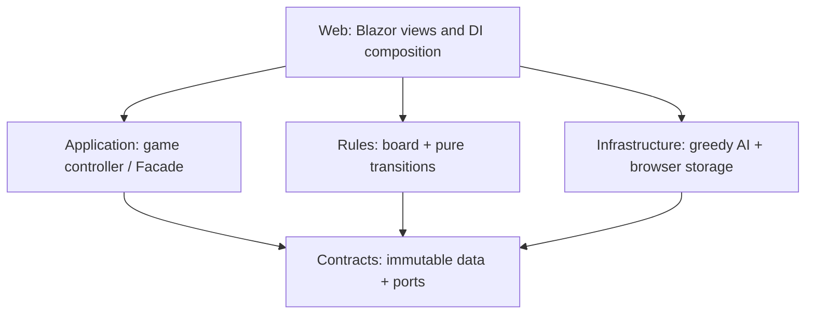

# Architecture and work plan for four contributors

This is the implementation plan for the requirements in [specification.tex](specification.tex), including F01–F08 and UC01–UC07. It divides work by independently testable components rather than by screens or successive phases. Contributors A–D are placeholders for the four team members. Assign names once; the responsibilities below then remain stable. The working rhythm is one 30-minute weekly catchup plus short written reviews when a shared contract changes. Start with [section 7](#7-concrete-delivery-milestones-and-weekly-catchups) for assignments and demo milestones; use sections 3–6 as the implementation reference. The final deadline is November 30, 2026; target a submission-ready version by November 23 to preserve a one-week contingency buffer. Track progress at each weekly catchup.

The official assignment permits C# with MAUI, WinUI or Blazor. This repository has already selected **C#, .NET 10, standalone Blazor WebAssembly**, and this plan keeps that decision. The application runs in the browser and can be deployed to a static HTTP(S) host. No backend, account system or database is required.

## 1. Scope and decisions to freeze first

The specification is the acceptance baseline. Keep these decisions in the first shared contract review:

| Topic | Required behavior |
| --- | --- |
| Participants | 2–4 players, each human or computer, at least one human; list order is turn order. |
| Board | 12 columns × 10 rows, six colors, no wrapping; adjacency means a shared hex edge. |
| Initial territory | Different corner starts and different player colors; initially capture the entire same-color component connected to each start. |
| Move | Recolor the player's **whole territory**, then capture all reachable neutral cells of the chosen color. Opponent cells cannot be captured or traversed. |
| Legal colors | Exclude every player's current color, including the acting player's own color. |
| Turn | Exactly one complete move, then the next participant. Invalid input leaves state and order unchanged. A legal zero-gain move still advances the turn. |
| Computer | Greedy full-component gain; ties use the fixed palette order below. Zero gain still produces a legal move. |
| End | Finish when there are no neutral cells, including immediately after initialization. All players with the maximum score win; multiple winners mean a draw. |
| Persistence | One versioned JSON save in `localStorage`; save only during an idle human turn. Resume from setup, preserving the board and next player exactly. |
| New game | Return to setup, invalidate pending computer work, and keep the previous saved game. An interrupted game has no winner. |
| Presentation | SVG board, owners and colors, current player, scores and neutral count; current stable desktop Chrome/Edge at 1280 × 720 or larger. |

The following implementation choices resolve details left open in the specification; they do not add features:

- IDs are zero-based. Cell ID is `row * 12 + column`; player ID equals its initial position in the player list and never changes.
- Use pointy-top hexes with **odd rows shifted right** (odd-r coordinates). See section 3 for the exact neighbor convention.
- Assign starts in this order: `(0,0)`, `(11,9)`, `(11,0)`, `(0,9)`. Take the first N for N players. Two players therefore start at opposite corners.
- Freeze palette IDs and tie order: `Red=0, Orange=1, Yellow=2, Green=3, Blue=4, Purple=5`. UI CSS colors may change without changing these IDs.
- Generate board colors uniformly from those six IDs; assign distinct colors to start cells by sampling without replacement, then compute initial territories. A seed is an internal testing parameter, not a user-facing feature.
- JSON version is `1`; storage key is `territory-capture.save.v1`. Do not add difficulty levels, networking, a board editor or alternative platforms before the specified workflow is complete.

The official wording says play continues while there is capturable territory. The specification makes this precise as “neutral cells remain.” With six colors and at most four distinct player colors, a legal color always exists; a zero-gain move is not a stopping condition. Do not introduce a “no immediate gain” ending rule.

## 2. Project boundaries and ownership

Create one solution with the following projects. The starter solution now provides these projects, shared contracts, test support and a development preview. Rules, Application and Infrastructure await implementation; the preview is not a playable game. See README for local commands.

```text
src/
  TerritoryCapture.Contracts/       Shared immutable types and interfaces
  TerritoryCapture.Rules/           A: pure rules and board generation
  TerritoryCapture.Application/     B: controller/facade and view projection
  TerritoryCapture.Infrastructure/  D: greedy strategy, JSON and browser storage
  TerritoryCapture.Web/             C: Blazor components and composition root
tests/
  TerritoryCapture.Rules.Tests/           A
  TerritoryCapture.Application.Tests/     B
  TerritoryCapture.Infrastructure.Tests/  D
  TerritoryCapture.Web.Tests/             C
  TerritoryCapture.Integration.Tests/     B: controller/rules integration
  browser/                               D: published-app smoke checks
```

All projects target `net10.0`; Web uses the Blazor WebAssembly SDK. Use xUnit for rules, controller, strategy and codec tests. C uses bUnit for command wiring and disabled-input behavior. D owns a small Playwright smoke suite for a real move, automatic AI, and save/reload/resume; remaining browser acceptance cases may be checked manually and recorded. Do not build a second comprehensive test suite around every UI detail. Pin compatible dependency versions and the SDK when creating the solution; commit dependency lockfiles and use locked restore locally. Each contributor writes and runs tests for their own component before handing it over. The project coordinator will create a basic pipeline that runs the whole-project tests; pipeline setup is not a contributor deliverable or a prerequisite for local work.



Arrows are **compile-time references**, not calls to concrete implementations. At runtime DI supplies the rules engine, strategy and storage adapter to the controller. Web also references Rules to register its implementation. Application must not reference Infrastructure, Rules implementations, Blazor or JavaScript. Rules and Contracts must not reference browser APIs. Infrastructure uses `IJSRuntime` only in its browser adapter; its codec and strategy are ordinary .NET classes.

Contracts is one small shared assembly, not a fifth development stream. A owns its board/state and rules types; B owns the controller, persistence port and view types; D owns the strategy port and serialized schema. C reviews UI usability of the public facade. B coordinates public-contract decisions; D owns solution-wide configuration; the project coordinator owns the basic whole-project test pipeline. Replace A–D in the table below with actual names before starting. This table is the ownership record; a separate CODEOWNERS setup is optional.

| Contributor | Owned implementation | Requirements / use cases (IDs from the specification) | Independent development substitute |
| --- | --- | --- | --- |
| **A — rules and model** | Hex geometry, generation, move validation, capture, score/end derivation, state validation | **Requirements:** F01 setup/initial board, F02 capture, F03 turn advancement, F05 score calculations, F06 finish/winners. **Use cases:** UC01 start game, UC02 human move, UC04 view results. | Hand-built immutable states; no UI, storage or AI needed |
| **B — application and integration** | Game controller, command admission, turn lifecycle, cancellation, view projection, DI contract coordination and integration tests | **Requirements:** F01–F08 orchestration of setup, moves, turns, AI, game display, finish/reset, save and resume. **Use cases:** UC01 start game, UC02 human move, UC03 computer turn, UC04 view results, UC05 new game, UC06 save, UC07 resume. | Fake rules engine, controllable strategy and in-memory save store |
| **C — Blazor presentation** | Setup/game/result screens, SVG grid, palette, owner labels, scores, errors, component tests, Web composition and static-host instructions | **Requirements:** F01 setup UI, F03 turn/input display, F05 board/scores, F06 results/new game, F07 save feedback, F08 resume feedback. **Use cases:** UC01 start game, UC02 human move, UC04 view results, UC05 new game, UC06 save, UC07 resume; UC03 computer-turn indication. | Fake controller with predefined setup/human/computer/result views |
| **D — strategy, persistence and tooling** | Solution/test setup, greedy strategy, JSON schema/codec, browser save adapter, storage errors, adapter/strategy tests and browser smoke suite | **Requirements:** F04 greedy AI, F07 save storage, F08 load storage. **Use cases:** UC03 computer turn, UC06 save, UC07 resume. | Fake rules engine, fixture states, in-memory/fake JavaScript storage |

B owns controller integration, not every shared task. D owns the build skeleton and browser smoke suite; C owns Web composition, UI integration and deployment instructions; A supplies validated fixtures and all game calculations. Each person connects their own delivery through the agreed interface and supplies passing tests. B does not fix another owner's implementation on their behalf.

## 3. Shared data and pure rules contract

Commit real compilable definitions corresponding to the signatures below before splitting implementation work. These are the agreed API blueprint. Use `System.Collections.Immutable`; a record containing a mutable array or list does **not** satisfy the immutability contract.

```csharp
public enum GameColor { Red, Orange, Yellow, Green, Blue, Purple }
public enum PlayerKind { Human, Computer }
public enum GamePhase { Running, Finished }

public sealed record CellState(int Id, GameColor Color, int? OwnerId);
public sealed record PlayerState(
    int Id, PlayerKind Kind, int StartCellId, GameColor Color);
public sealed record NewGameOptions(ImmutableArray<PlayerKind> Players);

public sealed record GameState(
    int Width,
    int Height,
    ImmutableArray<CellState> Cells,
    ImmutableArray<PlayerState> Players,
    int CurrentPlayerIndex,
    long TurnNumber,
    GamePhase Phase);

public enum RuleError {
    None, InvalidOptions, InvalidState, FinishedGame,
    UnknownPlayer, WrongTurn, IllegalColor
}
public sealed record StateResult(GameState? State, RuleError Error);
public sealed record MoveResult(
    GameState? State, int CapturedCount, RuleError Error);
public sealed record ValidationResult(
    bool IsValid, ImmutableArray<string> Problems);
public sealed record PlayerScore(int PlayerId, int Score);
public sealed record GameSummary(
    ImmutableArray<PlayerScore> Scores,
    int NeutralCount,
    ImmutableArray<int> WinnerIds);

public interface IGameRules {
    StateResult Create(NewGameOptions options, int seed);
    ImmutableArray<GameColor> LegalColors(GameState state);
    MoveResult ApplyMove(GameState state, int playerId, GameColor color);
    ValidationResult Validate(GameState state);
    GameSummary Summarize(GameState state);
}
```

Contract semantics:

- Result success means `Error == None` and a non-null state. Failure means non-`None` error and null result state. The original state is unchanged in both cases. Expected user errors do not throw exceptions.
- `Create` returns exactly 120 cells in ascending ID order and players in turn order; `TurnNumber = 0`, `CurrentPlayerIndex = 0`. It establishes all initial territories and detects an already-full board. A fixed seed is repeatable with the pinned implementation. Invalid participant counts or all-computer options return `InvalidOptions`.
- `LegalColors` uses the fixed palette order. For a finished state it returns an empty array. Normal rule operations receive validated states; persistence uses `Validate` before handing state to them.
- `ApplyMove` checks phase, acting player and color, recolors the complete territory, and floods only neutral cells of the chosen color from **all territory boundaries**. It returns the full immutable successor and the number of newly owned cells. Ownership cannot transfer between players.
- A successful move increments `TurnNumber` once. If neutral cells remain, it sets the next player index modulo player count; otherwise it marks `Finished` and leaves the final acting player index. This pure next-state calculation belongs to Rules; Application decides when a human or computer may initiate it. Do not advance the turn in both components.
- `Summarize` returns scores in player order and winner IDs in player order. Scores are counts of owner IDs, not separately stored counters. Neutral count is the number of null owners. Winner IDs are derived only for a finished state and otherwise are empty. Application uses this summary for its view projection, so winner/score rules have one implementation. No second independently mutable representation of territory or score exists.
- Rules permits moves by either player kind. Only the application enforces whether a command came from a human or from the computer turn runner.

For `(c,r)`, always consider `(c-1,r)` and `(c+1,r)`. On even rows add `(c-1,r-1)`, `(c,r-1)`, `(c-1,r+1)`, `(c,r+1)`; on odd rows add `(c,r-1)`, `(c+1,r-1)`, `(c,r+1)`, `(c+1,r+1)`. Remove out-of-bounds positions; never wrap. Specify this in fixture tests independently of the implementation.

C uses the matching SVG geometry: for radius `s`, center `x = sqrt(3) * s * (c + 0.5 * (r % 2))`, `y = 1.5 * s * r`, plus a positive margin. Polygon vertices start at a 30-degree angle and advance by 60 degrees. Sharing this convention prevents a visually adjacent pair from being logically disconnected. UI layout code does not perform capture or determine legal moves.

`Validate` rejects invalid dimensions/cell order or count; undefined enums; duplicate/non-sequential player IDs; invalid participant configuration or start placement; missing/foreign owner IDs; invalid current index or negative turn number; duplicate player colors; missing owned start cells; owned cells whose color differs from the owner's current color; disconnected player territory; and phase inconsistent with the neutral count. It also rejects incomplete capture closure: a neutral cell adjacent to an owner's territory cannot have that owner's current color in a completed state. It need not prove that a saved state is historically reachable through a particular sequence of moves.

## 4. Controller, UI and asynchronous behavior

The controller is the **Facade** promised by the specification and the sole owner of the active session. UI components receive immutable views and submit commands. They never mutate a `GameState`, call the rules engine directly, select AI moves or write saves.

```csharp
public readonly record struct ViewToken(Guid SessionId, long Revision);
public enum Screen { Setup, Game, Result }
public sealed record PlayerView(
    int Id, PlayerKind Kind, GameColor Color, int Score);
public sealed record GameView(
    ViewToken Token,
    Screen Screen,
    GameState? State,
    bool IsBusy,
    bool CanSave,
    ImmutableArray<GameColor> LegalColors,
    ImmutableArray<PlayerView> Players,
    int NeutralCount,
    ImmutableArray<int> WinnerIds,
    CommandError BackgroundError);

public enum CommandError {
    None, InvalidOptions, NotAllowed, Busy, StaleView, IllegalColor,
    MissingSave, InvalidSave, UnsupportedSaveVersion, StorageUnavailable,
    UnexpectedFailure
}
public sealed record CommandResult(CommandError Error);

public interface IGameController {
    GameView View { get; }
    event Action? Changed;
    ValueTask<CommandResult> StartAsync(NewGameOptions options);
    ValueTask<CommandResult> ChooseColorAsync(
        ViewToken expected, GameColor color);
    ValueTask<CommandResult> SaveAsync(ViewToken expected);
    ValueTask<CommandResult> ResumeAsync();
    ValueTask<CommandResult> ReturnToSetupAsync();
}
```

`GameState` in a view is read-only board data. `Players` adds scores from the rules summary; `WinnerIds` is empty unless the game finished. The application computes `CanSave` and legal human buttons; during computer turns, busy operations or results, the view's legal colors are empty. `BackgroundError` is normally `None` and exposes a supervised computer-runner failure that has no awaiting UI command. Error enum values map to UI messages; exception text is not a user-facing error message.

The token prevents a delayed click or double click from becoming a move on a later human turn. Increment revision on every view transition, including busy changes; issue a new session ID on start, successful resume and return to setup. Invalid commands do not increment game turn number. `StartAsync` and `ResumeAsync` are accepted only from idle setup. `ChooseColorAsync` requires a matching token and an idle running human turn. `SaveAsync` has the same token/admission rules and never changes the game state.

Commands return after their own operation commits; starting a game or choosing a color does **not** wait until every subsequent computer turn completes. The controller schedules and supervises a single computer loop:

1. Publish the current computer player and disable human actions before yielding to the browser.
2. Ask the strategy for a color using a captured immutable state.
3. Before committing, check cancellation, session identity and the captured state/revision. A result from an abandoned session cannot enter the new game.
4. Apply the move once through `IGameRules`, publish the successor, and yield between consecutive computer turns so the browser can render and process “New game.”
5. Stop on a human turn, finished game or cancellation. Never recursively launch another runner from `Changed`.

The greedy calculation is small and can be synchronous inside an asynchronous runner. Do not assume browser WebAssembly supports background threads or use `Task.Run` as a substitute for yielding. Make the yield/delay injectable in Application tests, so tests can pause a pending computer turn without real timeouts.

Use a short command admission gate: check/admit and capture state before awaiting an external operation. Do not hold that gate across strategy/storage awaits in a way that prevents return to setup. `ReturnToSetupAsync` cancels pending work and immediately publishes setup, even while the previous runner is yielding. Serialize other mutations and reject reentry. Unexpected AI failures must be observed and publish `BackgroundError = UnexpectedFailure`, with move/save input remaining disabled until reset; do not silently select an arbitrary fallback color. Reset clears the background error. Expected cancellation during reset is not a failure.

Similarly, a save/load completion for an old session must not overwrite the new session's view. A previously admitted save may have written its captured valid snapshot; returning to setup does not promise to undo that write. Never display its late success message on a different session. Dispose event subscriptions and cancellation sources. C marshals `Changed` callbacks through Blazor `InvokeAsync` and unsubscribes when a component is disposed.

## 5. Strategy and persistence contracts

```csharp
public interface IComputerStrategy {
    GameColor ChooseColor(GameState state, IGameRules rules);
}

public sealed record GameSnapshot(int Version, GameState State);
public enum StoreError {
    None, Missing, InvalidData, UnsupportedVersion, Unavailable
}
public sealed record StoreResult(StoreError Error);
public sealed record LoadResult(GameSnapshot? Snapshot, StoreError Error);

// Application-owned port; defined in Contracts for independent compilation.
public interface IGameSaveStore {
    ValueTask<StoreResult> SaveAsync(
        GameSnapshot snapshot, CancellationToken cancellationToken);
    ValueTask<LoadResult> LoadAsync(CancellationToken cancellationToken);
}
```

**Greedy AI:** receive a valid running state whose current player is a computer. Evaluate every color from `LegalColors` by calling the same `ApplyMove` used for actual moves; compare `CapturedCount`. Choose the first maximum in the palette order. Evaluation never changes the supplied state, and the strategy never commits a move or advances the controller. There is no separately implemented flood-fill for AI. An empty legal-color list in a running valid game is an invariant violation, not a pass turn.

**JSON codec:** D owns an explicit version-1 DTO representation and fixed camelCase property names. Do not serialize controller/view objects, tokens, `IsBusy`, events, dependencies, cancellation or cached scores. Store `version` and the entire state: dimensions; ordered cells with `id`, `color`, nullable `ownerId`; ordered players with `id`, `kind`, `startCellId`, `color`; `currentPlayerIndex`, `turnNumber`, `phase`. Use numeric enum IDs from section 1. Freeze a representative valid fixture and the property names in tests. Future schema changes require an explicit version decision, not silent serializer defaults.

Missing required properties must be errors, even if C# would otherwise supply a plausible default such as zero. Reject malformed JSON, null arrays, undefined enum values, unsupported versions and unreasonable input size before allocating game objects (a 256 KiB limit is ample for this fixed board). Unknown nonessential properties can be ignored for version 1. Deserialization must not run board generation or create replacement cells.

Validation has two distinct owners:

1. **D:** the store/codec checks JSON structure and version. Success returns a candidate snapshot; it does not establish game validity. On failure, `LoadResult.Snapshot` is null.
2. **B using A:** before installing the candidate, call `IGameRules.Validate`. Then enforce the save policy: a running state at a human turn. A structurally valid snapshot with inconsistent ownership, a finished state or a computer turn is an invalid save. On any failure, remain in setup with no partial state.

On save, B captures an already validated, complete state at an idle human turn and passes a version-1 snapshot. D serializes fully **before** replacing the stored value. Use one `localStorage.setItem` call, without first deleting the old save. Catch browser access/quota failures and map them to `Unavailable`; never report success after a failed write. Pass cancellation through the supported API, but do not claim it can roll back a write already performed in JavaScript.

Keep the adapter thin: codec unit tests use strings; storage tests use fake JS calls; the actual browser test verifies `setItem/getItem` survive reload at the same origin. `localStorage` contains only local game data; no server synchronization or authentication is introduced.

## 6. Individual acceptance checks

Each contributor's PR must run without the others' unfinished implementations. The table is the component's cumulative acceptance checklist, not a requirement to complete every case in its first PR. Automate rules, controller, strategy and codec correctness; C automates command wiring and input gating, and records visual/layout checks manually. Test doubles live in test projects or an explicit development-only harness and are never selected by the release composition root. Agree on a small shared fixture pack, including exact expected owners, next player and scores; do not generate expected answers by calling the implementation under test.

| Owner | Minimum independently verifiable cases |
| --- | --- |
| A | All six neighbors for interior even/odd rows; corners/edges and no wrap; symmetric adjacency; valid generation for 2/3/4 players and rejection of invalid options; distinct starts/colors and initial component capture; multihop capture from different territory boundaries; opponent blocking; own/opponent color rejection without mutation; zero gain advances; wraparound turn; score sum plus neutral count is 120; win/draw and initial end detection; all state-validation invariants. |
| B | Admission in setup/human/computer/busy/finished states; stale tokens and double clicks; exactly one move/turn increment; automatic consecutive computer turns ending at a human; initially finished game; reset while AI is pending and discarded late result; stale storage completion; save only at an idle human turn; load errors remain in setup; validated load restores exactly; reset preserves save; subscribed views contain correct legal buttons/scores/winners. |
| C | Setup permits 2–4 mixed participants with at least one human; fake controller commands carry the rendered token; 120 polygons with correct odd-r placement; owners readable without relying on color alone; current player/scores/neutral count; illegal buttons disabled; computer and busy states disabled; draw/result and new-game screen; save/load error messages; unsubscribe on disposal; readable layout at 1280 × 720. |
| D | AI chooses largest **full** component rather than immediate neighbor count; palette tie order; legal choice when all gains are zero; no input-state mutation; version-1 round trip preserves every state field; missing fields/invalid JSON/size limit/unsupported versions; missing save; fake JS unavailable/quota failure; overwrite without delete; failed write retains old value; canceled operation never installs partial state. |

For small hand-built capture/AI examples, construct a 120-cell board with a controlled local pattern and irrelevant regions filled deliberately. Helpers must create internally valid ownership and player colors. For initialization edge cases that random generation rarely produces, A may use an internal deterministic color source exposed to the test assembly; it is not a production gameplay interface.

Use the following invariants as assertions in the explicit move tests; a separate property-testing framework is optional: all owned territories remain monochromatic and connected; cell count stays fixed; existing opponent owners never change; a move cannot reduce territory size; and the old immutable state stays identical after simulation. Random-seed samples are useful but do not replace the explicit edge-case assertions.

## 7. Concrete delivery milestones and weekly catchups

Work through these milestones in order, using the target dates below. Owners may start later independent tasks as soon as their contracts exist. Do not defer a ready integration until the meeting.

| Target date (2026) | Required result |
| --- | --- |
| October 26 | Milestone 0: contracts, fixtures and runnable skeleton; everyone can work independently. |
| November 9 | Milestone 1: a real human game works through the browser UI. |
| November 16 | Milestone 2: all required workflows work with real components; feature freeze. |
| November 23 | Milestone 3: acceptance, documentation and submission package complete; ready to submit. |
| November 24–30 | One-week contingency buffer for unexpected defects, packaging or submission issues. |
| November 30 | Final submission deadline. |

Plan ordinary implementation, acceptance and documentation to finish by November 23. The buffer is not allocated to unfinished features or optional polish. Submit once the package is ready and submission is available; November 30 is the deadline, not the planned finishing day.

### Milestone 0 — everyone can work alone

Complete the shared setup first, targeting October 26. This is the only deliberate shared startup dependency. During setup, owners can begin private implementation and UI layout work against the draft contracts; merge the agreed contracts before connecting components. This lets later implementation overlap with setup rather than waiting until October 26 to start.

| Owner | Deliverable |
| --- | --- |
| D | Create the solution/projects, pinned SDK/dependencies and local test setup. Commit the exact build/test commands so everyone can run their own tests and the whole-project tests locally. |
| A | Commit the section 3 state/rules contracts and shared fixtures for a valid human turn, a valid computer turn, multihop capture, zero gain and a draw. Record expected owners, gains, scores and next player by hand. |
| B | Commit the section 4 controller/view contracts and section 5 save port. Add controllable rules/strategy/storage doubles for controller tests, including a paused computer turn. Coordinate the short contract review. |
| C | Add a runnable Web shell with a fake controller showing setup, human, computer and result views. Verify that the facade provides everything needed to render and submit commands. |
| D with A | Commit the strategy/snapshot/store-result contracts and a valid version-1 JSON fixture matching A's human-turn state. |

Confirm the shared dependency signatures during setup. Merge the skeleton and contracts before implementation branches diverge. After this milestone, each owner must be able to build and demonstrate their component without another unfinished implementation. Shared fixtures live in one test-support location created by D; A owns their game-state contents. C's fake controller stays in an explicit development harness and cannot be registered by release startup.

**Demo/check:** clean checkout builds and tests; C can run the fake UI; A, B and D can run their own fixture-based tests. Record the commands in README. Do not spend this milestone polishing screens or implementing all rules.

### Milestone 1 — a real human game

| Owner | Deliverable |
| --- | --- |
| A | Implement generation, hex neighbors, legal colors, capture, turn advancement, summary and end detection. Supply focused tests for adjacency, full capture, opponent blocking, zero gain, immutable input and win/draw. Begin save-state validation. |
| B | Implement start, human move admission, view projection and return to setup against doubles; connect real Rules as soon as A's start/move path is ready. Test stale clicks and exactly one move per accepted command. |
| C | Implement participant setup, SVG board, owner labels, scores, palette and result view against the fake controller. Connect the real controller through the same interface as soon as B's human path is ready; own the Web DI edits. |
| D | Implement greedy selection against fixtures and JSON encode/decode with round-trip and invalid-input tests. Run the strategy/codec tests locally; document service registrations for C. |

**Demo/check:** start a real two-human game in the browser, make several moves, verify capture and scores, and return to setup. A demonstrates a deterministic win/draw fixture through tests. UI polish, storage and automatic AI may still be unfinished. Missing owners/state/turn behavior blocks this milestone; spacing and visual polish do not.

### Milestone 2 — every required workflow works

| Owner | Deliverable |
| --- | --- |
| A | Finish `Validate`, including ownership, connectivity, capture closure and phase consistency. Add any missing initialization/invalid-state cases. Support integration defects in Rules. |
| B | Implement the supervised computer loop, cancellation/reset, save/load admission and validated resume. Test consecutive computer turns, reset during a paused turn and ignored old-session completions. Connect D's real services. |
| C | Connect all real services in release DI. Show computer/busy states, save/resume controls and errors. Verify tokens and disabled input with focused component tests. |
| D | Finish the browser storage adapter and error mapping. Verify failed writes preserve the previous save. Add Playwright smoke checks against published output for a move, automatic AI and exact save/reload/resume. |

Integrate in this order as services become ready: Rules + controller; strategy + controller; UI + controller; storage + controller + UI. C makes the Web registrations using each owner's supplied example; B handles orchestration mismatches; defects within a component return to its owner.

**Demo/check:** start a human–computer–computer game, observe automatic turns, make a human move, save, reload and resume with the exact board and next player. Reset while a computer turn is pending and show that it cannot affect a new game. Missing/corrupt saves show an error and leave setup usable. No required workflow may rely on a fake.

### Milestone 3 — ready to submit

| Owner | Deliverable |
| --- | --- |
| A | Close remaining rules defects; document the state invariants and capture algorithm. |
| B | Complete the F01–F08/UC01–UC07 acceptance checklist, mapping each item to a test or recorded manual check; document controller lifecycle and dependencies. |
| C | Check the published application in actual stable Chrome and Edge at 1280 × 720, including owner readability, final win/draw views and new game. Record browser versions and finish static-host/README instructions. |
| D | Verify locked restore, Release build/tests, publish and browser smoke suite from a clean checkout. Document the JSON schema and save behavior. |

Use a development/test-only deterministic fixture to reach win/draw states; do not add a production arbitrary-state import control. Check remaining browser cases manually: illegal input, result/new game, missing/corrupt saves and usable layout. Record the outcome; do not require a separate automated browser test for every acceptance item. Every feature needs evidence with real components, even when its focused unit tests use doubles.

**Demo/check:** a teammate follows README from a clean checkout, serves the published output over HTTP, and plays/saves/resumes without help. All required features pass, release startup uses real services, and no known defect prevents acceptance. No additional features until this milestone passes.

The skeleton must verify and record the actual commands, expected to include `dotnet restore --locked-mode`, `dotnet build --configuration Release --no-restore`, `dotnet test --configuration Release --no-build`, and `dotnet publish src/TerritoryCapture.Web/TerritoryCapture.Web.csproj --configuration Release --no-restore`. D also records the separate browser-test command and installation instructions. README records the starter commands; owners extend the checks as real components arrive.

### Weekly catchup — 30 minutes, one shared checklist

B maintains the checked-in `docs/delivery-status.md` supplied with the starter. It contains the names assigned to A–D, current milestone, each owner's next deliverable, open blockers with decision owner, and links to merged PRs/demo evidence. This is the status source; do not create parallel personal status documents.

Before the catchup, each person updates their row with: **delivered**, **next**, and **blocked**. During the catchup:

1. **10 minutes:** demonstrate the current integrated application. Before the first real integration, show the runnable harness and component tests. Discuss observed failures rather than reciting activity.
2. **10 minutes:** resolve open boundary decisions and assign integration defects to their component owners.
3. **10 minutes:** agree on one concrete deliverable per person for the next catchup and update the checklist. A deliverable must state what will run or what test will pass.

End with four written assignments and a named owner for every blocker. If a milestone slips, carry forward its missing required behavior and defer polish or optional testing infrastructure. If a target date is at risk, reassign a specific remaining task and defer optional polish at that catchup; keep November 23 as the submission-ready target. Weekly catchups remain the coordination rhythm.

## 8. Independent work between catchups

- Deliver the assigned component working against the agreed contracts and milestone acceptance checks.
- Create a PR for each delivery, briefly describing what works.
- Write and run the relevant tests locally; include the test commands and results in the PR.
